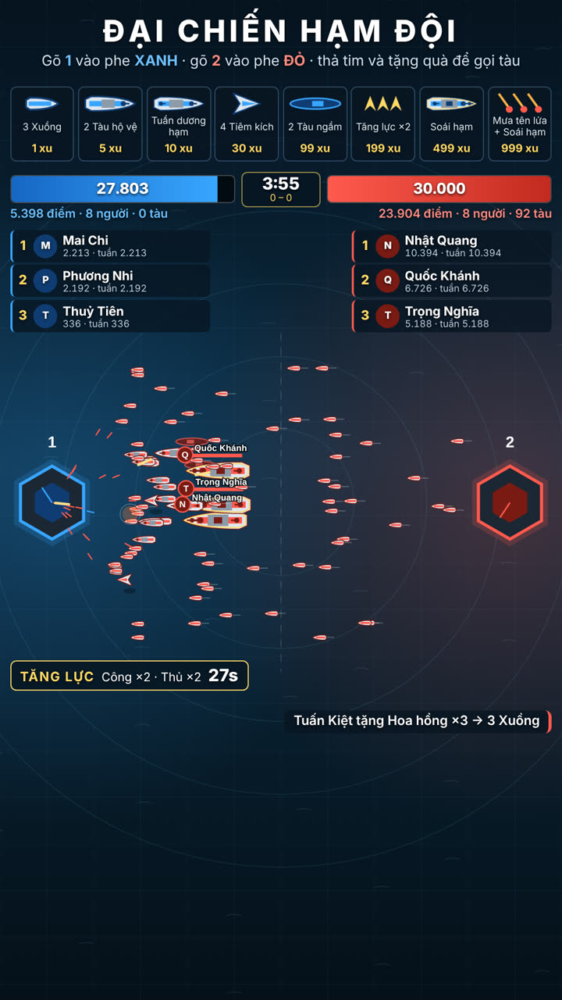

# Đại Chiến Hạm Đội

Game tương tác cho TikTok LIVE: hai phe XANH và ĐỎ đánh hải chiến, người xem điều khiển trận đấu bằng bình luận, tim và quà. Game chạy trong trình duyệt trên máy streamer; OBS hoặc TikTok LIVE Studio quay trang đó để phát.



## Cách chơi (phía người xem)

| Hành động | Kết quả |
| --- | --- |
| Bình luận `1` hoặc `xanh` | Vào phe XANH, nhận 2 xuồng |
| Bình luận `2` hoặc `đỏ` | Vào phe ĐỎ, nhận 2 xuồng |
| Bình luận bất kỳ (đã có phe) | 1 xuồng, tối đa 5 giây một lần |
| Thả tim | Cứ 10 tim được 1 xuồng |
| Follow / chia sẻ | 1 / 2 tàu hộ vệ |
| Tặng quà | Gọi tàu theo giá xu của món quà (bảng dưới) |

| Giá một món quà | Phần thưởng |
| --- | --- |
| 1 xu | 3 xuồng cao tốc |
| 5 xu | 2 tàu hộ vệ |
| 10 xu | 1 tuần dương hạm + 1 tàu hộ vệ |
| 30 xu | 4 tiêm kích |
| 99 xu | 2 tàu ngầm + 1 tuần dương hạm |
| 199 xu | Tăng lực (công ×2, thủ ×2 trong 30 giây) + 3 tuần dương hạm |
| 499 xu | Soái hạm mang tên và ảnh đại diện người tặng |
| 999 xu | Mưa tên lửa + soái hạm |

Quà tặng theo combo được nhân theo số lượng. Người chưa chọn phe mà thả tim hoặc tặng quà sẽ được xếp vào phe đang ít người hơn.

Một trận kéo dài tối đa 5 phút. Phe nào phá được căn cứ đối phương thì thắng; hết giờ thì phe còn nhiều máu căn cứ hơn thắng. Sau màn kết quả, trận mới tự bắt đầu và mọi người chọn phe lại. Điểm tuần của từng người được lưu trong trình duyệt của streamer.

## Chạy game

Cần Node.js 18 trở lên.

```bash
npm install
npm start            # mở http://localhost:3000
```

Thử không cần TikTok:

- `http://localhost:3000/?demo=1` — tự giả lập một phòng live đông người.
- `http://localhost:3000/?debug=1` — hiện bảng điều khiển để bấm thử từng loại quà. Phím `H` bật/tắt bảng này.

## Nối với phòng TikTok LIVE thật

Mở cửa sổ dòng lệnh thứ hai, trong lúc tài khoản đang phát live:

```bash
cd server
npm install
node index.js ten_tai_khoan_tiktok
```

Cầu nối đọc sự kiện của phòng live và đẩy sang game qua `ws://localhost:8081`. Game tự kết nối và tự nối lại khi rớt. Đổi địa chỉ bằng tham số `?ws=ws://may-khac:8081`, đổi cổng bằng biến môi trường `PORT`.

Cầu nối dùng thư viện không chính thức [`tiktok-live-connector`](https://github.com/zerodytrash/TikTok-Live-Connector). Thư viện này có thể ngừng hoạt động khi TikTok thay đổi giao thức, và bị giới hạn số lần kết nối nếu không có khoá của dịch vụ ký Euler Stream (đặt qua biến môi trường `EULER_API_KEY`).

## Phát lên TikTok

1. Trong OBS hoặc TikTok LIVE Studio, thêm nguồn **Browser** trỏ tới `http://localhost:3000`, kích thước 1080×1920.
2. Game chừa trống phần dưới màn hình để khung bình luận của TikTok không che chiến trường.
3. Bảng điều khiển nằm ngoài khung 9:16 nên không lọt vào hình phát.

## Cấu trúc mã nguồn

| File | Vai trò |
| --- | --- |
| `src/game/config.js` | Toàn bộ số liệu cân bằng: chỉ số tàu, bậc quà, luật trận |
| `src/game/engine.js` | Mô phỏng trận đấu, xử lý sự kiện, tính điểm (không phụ thuộc giao diện) |
| `src/game/renderer.js` | Vẽ chiến trường lên canvas |
| `src/game/eventSource.js` | Kết nối cầu nối WebSocket và bộ giả lập người xem |
| `src/App.js` | Vòng lặp game, HUD, bảng điều khiển |
| `server/index.js` | Cầu nối TikTok LIVE → WebSocket |

Kiểm thử phần lõi: `CI=true npm test`.
